# Ridgeline

Planning a route usually means cross-referencing half a dozen separate agencies—wildfire maps, weather alerts, river gauges, avalanche centers, and air quality monitors—and working out by hand where they intersect a trail. Ridgeline takes a GPX, KML, or GeoJSON track and checks it mile by mile against those public feeds at once, returning a clear summary of what affects the route and where.

It is built for two moments:

- **Planning** — the whole route, days before you go.
- **On trail** — your GPS position, what is ahead in the next 5–50 miles, refreshed as you move, readable on a phone in sunlight, and still useful offline with the last check clearly dated.

The software is built around two simple principles:

1. **Unknown conditions are never reported as clear.** Public feeds time out, monitoring stations go offline, and cell coverage drops in the mountains. When a source can't be reached, or a route passes outside US coverage or through unrated avalanche terrain, Ridgeline marks those miles as unchecked rather than safe, and retains the last known report until fresh data arrives.
2. **Reported facts are kept distinct from estimates.** Official warnings from agencies like NIFC, the National Weather Service, NOAA, and AirNow are separated from modeled trail conditions (snow, ice, and mud estimated from elevation, slope aspect, tree cover, and recent weather). On both the map and the elevation profile, official reports appear as solid lines and estimates as dashed or hatched—and estimates are capped at Moderate so an inference never outranks an official warning.



> Ridgeline summarizes public data. Conditions change fast and agencies can be slow to map them. Always check closures and forecasts with the land manager and the official sources before you go.

## What it checks

| Hazard | Source | How it is matched to the route |
| --- | --- | --- |
| Wildfire perimeters | NIFC WFIGS current perimeters | Every 0.1 mi of trail is tested against each active perimeter. Inside / within 1 mi / within 5 mi are graded separately. Fires that are 100% contained, controlled, declared out, or have a Final ICS-209 report are excluded, while active multi-month campaign fires are kept. |
| New fires without a mapped perimeter | NIFC WFIGS incident locations | Active incidents without a mapped perimeter have only a point of origin. Ridgeline estimates a footprint from reported acres and grades distance to it, dropping stale unclosed dispatches that have no active ICS-209 or containment. |
| Watches, warnings, advisories | NWS `/alerts/active` (refreshed every minute) | Warned polygons when present; otherwise the alert's forecast, fire-weather or county zone shapes. Severity sets the level; expired, cancelled and test messages are dropped. |
| Avalanche danger | avalanche.org forecast zones | Danger 1–5 and avalanche warnings, with the forecast's expiry checked at request time. Zones that are in season but unrated are reported as *not checked*, never as safe. |
| Flooding rivers and creeks | NOAA National Water Prediction Service gauges | Gauges at or above action stage (now or forecast) within 0.75 mi of the trail. Reservoir gauges are ignored. |
| Thunderstorms, wind, rain, snow, heat, cold | NWS gridded forecast (72 h) + Open-Meteo recent rainfall | Sampled along the route; temperatures are adjusted to trail elevation. These are **estimates** and are capped below official warnings. |
| Smoke and air quality now | EPA AirNow (hourly PM2.5 map and monitors, including Forest Service fire monitors) | Stretches inside an unhealthy AirNow area are official hazards (sensitive groups → low … hazardous → extreme). A monitor within 3 mi of the trail overrides the smoothed map. The nearest monitor's reading is shown. |
| Smoke overhead | NOAA Hazard Mapping System satellite smoke analysis | Plumes traced in the last 24 h are drawn on the map; heavy smoke over the trail is a low note (satellites see the whole air column, not ground-level air). |
| Smoke forecast | NOAA National Air Quality Forecast (PM2.5, ~5 km, bias-corrected), Open-Meteo CAMS where NOAA has no data | Peak AQI over the next 48 h, every 2 mi. An **estimate**, capped below official warnings. |
| Trail conditions | Ridgeline's own model from Open-Meteo hourly weather (10 days back, 3 ahead), LANDFIRE slope and aspect, USFS tree canopy, Annual NLCD land cover and NOAA's SNODAS snow analysis | Every 0.25 mi: snow (firm or soft, and when it softens), morning ice, mud, slick rock, dust, loose rock. Deterministic physics, no AI. Snow and ice show as **estimated** hazards; the rest is in the Modeled Trail Conditions tab. |

Every source reports its own health (`ok`, `stale`, `partial`, `error`). A failed or stale source is shown as such in the result and in each stretch's "checked" list — a data outage never reads as "clear".

## Using it

1. **Open a route.** Drop a GPX, KML or GeoJSON file, or press **Try a sample route** (the real John Muir Trail from OpenStreetMap). All tracks and track segments in the file are joined in order; a planned `<rte>` is ignored when the file also has a recorded `<trk>` of the trip. Only coordinates leave your device.
2. **Read the verdict.** The colored plaque gives the worst thing on the route and where; clicking it jumps straight to that hazard on the map. "Incomplete" (never green) appears when a source failed or part of the route is outside US coverage; the notes under it say exactly what wasn't checked.
3. **Scan the elevation strip and map.** Real elevation from your file with a hazard band underneath, paired with Start/End route markers, a one-click **Fit route** reset, and a toggleable **Map key** on the map. Hover or use the arrow keys to read any mile and its elevation; click to jump the map there.
4. **Dig in.** *What to know* ranks hazards with where they meet the trail, closest approach, timing, the agency's advice and a link to the official source. *Along the route* is a mile-by-mile log. *Trail* shows what is likely underfoot now and on the next mornings and afternoons, with the reasons. *Data* shows each source's health and age.
5. **On trail.** Switch to **On trail** and allow location (or set your position on the map, or type your trail mile). The plaque then reflects only what's ahead, with the next hazard, sunset and last light. It re-checks as you move a mile or every 15 minutes, sending only the route's fingerprint, not the whole file.
6. **Since your last check.** Reopening a route compares official hazards with your previous check on this device: new, cleared (only when that source is healthy now), worse or better.

Routes and results are kept in your browser (IndexedDB), so the last check stays readable with no signal, clearly dated. The installed app (production build) also caches its own shell and recently viewed map tiles. Clicking **Ridgeline** in the top-left returns to the start screen at any time.

## Running it

Requires Node.js 20.13 or newer.

```bash
npm install
```

```bash
npm run dev
```

Open http://localhost:5173. The API runs on port 3000 and Vite proxies `/api` to it.

To try it on a phone on the same network, run `npm run dev:lan` and open the printed network URL. Browsers only allow live GPS on HTTPS or `localhost`, so On-trail GPS on a phone needs an HTTPS deployment or HTTPS tunnel (or use "Set my position on the map" / enter your trail mile). When opened over HTTPS on iOS (Safari → Share → **Add to Home Screen**) or Android (Chrome → **Install app**), Ridgeline runs full-screen as an installable web app without requiring an app store.

### Production

```bash
npm run build
```

```bash
npm start
```

`npm start` serves the built app and the API from one Express process (port `PORT`, default 3000) with a strict Content-Security-Policy, compression, and long-lived caching for fingerprinted assets. Put it behind an HTTPS reverse proxy and set `TRUST_PROXY=1` so rate limiting sees real client IPs.

| Variable | Default | Purpose |
| --- | --- | --- |
| `PORT` | `3000` | HTTP port |
| `CONTACT_EMAIL` | placeholder | Contact address in the upstream User-Agent (NWS asks for one) — **set this** |
| `RATE_LIMIT_PER_MIN` | `30` | Analyses per minute per IP |
| `UPLOAD_LIMIT_PER_MIN` | `6` | Full-route uploads per minute per IP (refreshes by fingerprint don't count) |
| `TRUST_PROXY` | `0` | Reverse-proxy hops to trust for client IPs |
| `LOG_UPSTREAM` | unset | `1` logs every upstream request with timing |
| `VITE_BASEMAP_STYLE` | OpenFreeMap | Override the basemap style URL at build time |

## Tests and benchmarks

```bash
npm test
```

181 unit and integration tests run offline with injected sources or a stubbed network: geometry, caching (stale-while-revalidate, hung upstreams, negative caching), validation (including trip pacing bounds), every detector (including a 0.23-mile fire crossing that the old midpoint test missed, ended-fire safety filtering, elevation-downscaled weather, wind chill, NWS snow level, freezing-rain glaze, estimated snowmelt creek runoff, and trip ETA windowing up to 168 h), the engine (source outages, beyond-horizon legs, and non-US routes must never produce "clear"), measured air quality (monitor gaps, frozen or hung feeds), the smoke forecast fallback, the trail-conditions physics (wet-bulb partitioning, wind/gust turbulent fluxes, aging albedo, 8-azimuth horizon shading, canopy longwave trapping, melt-freeze crust, rain-on-snow, frost/dew/verglas inertia, slope drainage, and SNODAS bilinear seeding), sun times, the HTTP API, the panel logic that decides whether a stretch reads as clear (and formats route DEM stats, trip forms, conditions snapshots, diagnostic summaries, and route-log chunk selection), and production static serving (run `npm run build` first for that one).

```bash
npm run bench
```

Runs the full engine against the live services on `tests/fixtures/synthetic-pct.json` (a 3,410-mile synthetic line from Campo to the Canadian border — not the real PCT) and prints cold/warm timings, source health and the top hazards. Pass a GPX path to benchmark your own route, and `lat,lng` to benchmark On-trail mode. Typical numbers today: ~10 s cold (trail conditions included), well under 1 s warm for the full 3,410 miles; ~2.6 s cold and ~0.1 s warm for the 202-mile JMT.

## How it works

### System architecture


### Data pipeline


### Engine internals


- The browser and server measure the route with the same code (`shared/geo.js`), so "Mi 42.3" means the same place on the map, in the list and on the server.
- Refreshes send only the route fingerprint; the server keeps recent route models for 3 hours and asks for the full route again if it has forgotten it.
- No route, position or result is stored on the server. "Since your last check" is computed in the browser from the previous result on that device.
- National datasets (fires, alerts, avalanche zones, flooding gauges) are fetched once and shared across every request, so cost does not grow with users or route length.

```
server/
  app.js, index.js, config.js     Express app, security headers, static hosting
  api/router.js                   POST /api/analyze, GET /api/health
  lib/                            cache, HTTP client, validation, rate limit, spatial math
  sources/                        one adapter per upstream service
  fusion/                         route model, detectors/, consolidation, summary, engine
shared/                           geometry + severity scale used by server and browser
shared/conditions/                sun, surfaces, the hourly trail-conditions model and its plain-language reading
src/                              the web app (vanilla JS + MapLibre GL): map/, panels/, storage/, location/
public/                           service worker, manifest, icon, samples/ (real JMT GPX)
docs/assets/                      architecture, engine, pipeline, and route-anatomy SVG diagrams
tests/                            node:test suites and fixtures
scripts/bench.js                  live benchmark
```

## Data sources and attribution

- Wildfire perimeters and incidents: National Interagency Fire Center, WFIGS (IRWIN).
- Watches, warnings, gridded forecasts: National Weather Service (public domain).
- Avalanche forecasts: avalanche.org / National Avalanche Center and its member centers.
- River gauges: NOAA National Water Prediction Service.
- Measured air quality: EPA AirNow. Smoke forecast: NOAA National Air Quality Forecast Capability. Satellite smoke: NOAA Hazard Mapping System.
- Snow on the ground: NOAA NOHRSC (SNODAS). Terrain: LANDFIRE (USGS). Tree canopy: USFS NLCD Tree Canopy Cover. Land cover: Annual NLCD.
- Hourly weather history, recent rainfall and fallback air quality: [Open-Meteo](https://open-meteo.com/) (CC BY 4.0; air quality from Copernicus CAMS). Open-Meteo's free tier is for non-commercial use — a commercial deployment needs an Open-Meteo plan.
- Basemap: [OpenFreeMap](https://openfreemap.org/), © OpenMapTiles, © OpenStreetMap contributors. Terrain: Mapzen terrain tiles (USGS and others) on AWS Open Data.

## Known limits

- US coverage. Fire, alert, gauge and forecast data are US-only; points outside NWS coverage are reported as not checked.
- Forecast hazards cover the next 72 hours by default, or up to 168 hours along a timed itinerary when a start date and daily pace are provided (`trip`). Route miles scheduled beyond the forecast horizon are marked unchecked against forecasts rather than clear.
- Avalanche danger uses the zone's highest rating across elevation bands (conservative), paired with trail elevation band and `>=30°` steepness context rather than per-band danger bulletins.
- Fire perimeters can lag the fire by a day or more; incidents without perimeters are approximated as circles.
- Forecast samples are spaced up to ~28 miles apart on very long routes in Planning mode; On-trail mode samples every mile ahead of you.
- Trail conditions are a model, not an observation. The surface underfoot is inferred from 30 m land cover (Annual NLCD / USFS LCMS), slope, tree canopy, and 8-azimuth ridge horizon shading (OpenStreetMap rarely tags backcountry surfaces beyond "ground"); fine-scale cold-air pooling in meadows is not modeled, so morning ice in frost hollows can linger longer than shown. Snow older than ten days comes only from NOAA SNODAS (lower 48).

## License

Ridgeline is free software licensed under the [GNU Affero General Public License v3.0 or later](LICENSE) (`AGPL-3.0-or-later`).

The sample John Muir Trail track in [`public/samples/jmt-yosemite.gpx`](public/samples/jmt-yosemite.gpx) is derived from OpenStreetMap (ODbL 1.0) with elevations from Open-Meteo / Copernicus DEM (CC BY 4.0); see [`public/samples/README.md`](public/samples/README.md) for details.
