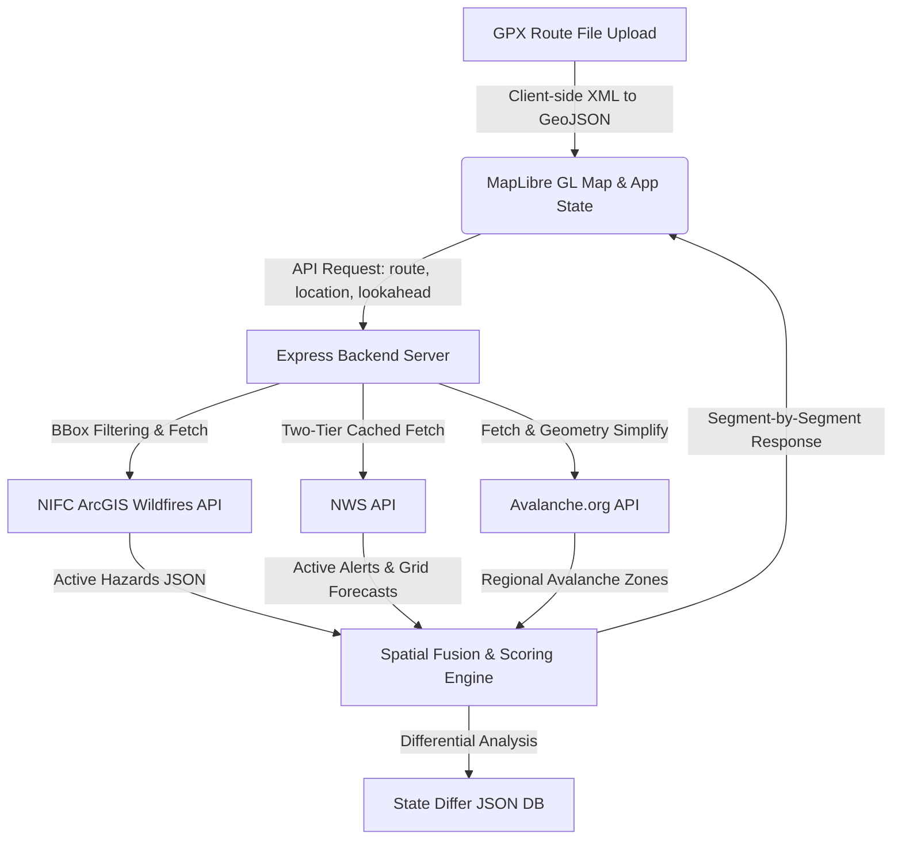

# Ridgeline — Backcountry Route Health & Hazard Analysis

Ridgeline is a premium, real-time backcountry safety analyzer designed for hikers, backpackers, and trail runners. It allows users to upload standard GPX route files (exported from AllTrails, CalTopo, FarOut, Gaia GPS, etc.) and automatically cross-references the route geometry against live hazard data from official federal and regional agencies. 

By fusing spatial geometries with active wildfire perimeters, National Weather Service (NWS) forecasts, and public avalanche advisories, Ridgeline highlights dangerous or degraded trail conditions before and during a trip.

---

## Key Features

### 1. Multi-Source Hazard Fusion
*   **Active Wildfires (NIFC/IRWIN):** Fetches live wildfire boundaries and prescribed burns directly from the National Interagency Fire Center (NIFC).
*   **Severe Weather & Alerts (NWS):** Fuses NOAA/NWS active meteorological alerts (watches, warnings, advisories) with point forecasts.
*   **Inferred Mud & Creek Hazards:** Analyzes recent and forecast precipitation levels to estimate mud hazard severity and identify elevated creek crossings.
*   **Avalanche Danger (Avalanche.org):** Integrates public regional avalanche forecasts to report danger levels (1-5 scale) and display specific travel advice.

### 2. Dual Modes of Operation
*   **Planning Mode:** Conducts a full-length scan of the uploaded route (suited for pre-trip preparation).
*   **On-Trail Mode:** Utilizes browser-based GPS tracking (with a graceful offline/no-signal fallback) to analyze only what lies ahead within a sliding **Lookahead Window** (customizable from 5 to 30 miles, default 15 miles).

### 3. Lookahead Window & Override Scan
In **On-Trail Mode**, the system optimizes performance by only chunking and scoring weather for the active lookahead window. However, to ensure absolute safety, an **Override Scan** runs in the background. It utilizes a low-overhead bounding box intersection to scan the entire trail length, warning users of severe hazards (e.g., active wildfires or Level 3+ avalanche zones) lying further ahead on the route.

### 4. Route Hazard Diffing ("Since You Last Checked")
Uses a lightweight local JSON-based state database (`data/differ_db.json`) keyed by a route identifier to compare the current analysis with the previous run. If new hazards are reported or old ones are cleared, they are highlighted in a dedicated delta panel in the sidebar.

### 5. Premium UI & Visual Safety Mapping
*   **Interactive Dark-Matter Map:** Built using MapLibre GL, displaying the route path color-coded by hazard status alongside overlays for fire perimeters, weather forecasts, and avalanche zones.
*   **SVG Route Status Strip:** Generates a deterministic elevation-style path in the sidebar showing safety status transitions with exact mile markers.
*   **Dashed/Solid Segment Styling:** Visual differentiation between official warnings (solid line segments) and inferred warning estimates like mud or wet crossings (dashed line segments).
*   **Segment Cards:** Breaks down route alerts into mile-by-mile segments featuring detailed descriptions and clear source attribution.

---

## Technical Architecture & Data Flow



### Data Sources & API Integrations
1.  **NIFC Wildfire Perimeters:** Queries the ArcGIS Feature Server `WFIGS_Interagency_Perimeters_Current` endpoint. Natively queries for features intersecting the padded route bounding box.
2.  **NWS Weather:** Queries `api.weather.gov/points` to resolve grid cells, followed by parallel fetches for grid forecasts and active alerts.
3.  **Avalanche Map Layer:** Queries `api.avalanche.org/v2/public/products/map-layer` to fetch nationwide regional avalanche forecast zones.

---

## Performance Engineering & Optimizations

Analyzing massive routes like the Pacific Crest Trail (~2,650 miles) or Appalachian Trail (~2,190 miles) presents substantial processing challenges. Ridgeline implements several optimizations to remain fast, memory-efficient, and responsive:

*   **Geometry Simplification:** High-resolution fire perimeters and avalanche zones are simplified server-side via `@turf/simplify` (0.0005° and 0.001° tolerances respectively) to reduce payload size and accelerate Turf.js intersection checks.
*   **Bounding Box (BBox) Guards:** Bounding boxes are pre-calculated for all fire and avalanche polygons during fetch caching. Before executing expensive polygon-in-point operations, the engine runs a fast numeric boundary check to instantly filter out irrelevant hazards.
*   **Two-Tier Weather Caching:** Weather requests are cached using `node-cache` in two tiers. First, the coordinate-to-grid mapping is cached by coordinates. Second, the grid forecast data is cached by grid coordinate (e.g. `nws-grid-MFR/72,50`). This allows nearby points along the route that map to the same grid cell to share a single cached API call.
*   **Parallelized Settled Fetches:** Weather points are fetched concurrently using `Promise.allSettled` wrapped in a 10-second timeout. If the NWS API encounters outages or delays, the promise is rejected, and the backend degrades gracefully (generating clear segments instead of crashing the request).
*   **Event Loop Yielding:** For long routes generating thousands of segments, the segment scoring loop yields control back to the Node.js event loop every 500 chunks using `setImmediate` to prevent blocking the main server thread.
*   **Segment Consolidation:** Contiguous 1-mile route chunks sharing identical hazard profiles are consolidated into single, continuous segments to reduce UI rendering load and payload size.

---

## Technology Stack

### Frontend
*   **Framework:** Vanilla HTML5 / ES Modules / CSS3
*   **Map Rendering:** [MapLibre GL JS](https://maplibre.org/maplibre-gl-js/docs/)
*   **GPX Parsing:** `@tmcw/togeojson` & `xmldom`
*   **Styling:** Modern dark theme featuring glassmorphism, responsive grid layouts, and custom fonts (*IBM Plex Mono*, *IBM Plex Sans Condensed*).
*   **Build Tool:** Vite

### Backend
*   **Server:** Node.js & Express
*   **Spatial Calculations:** Turf.js (`@turf/along`, `@turf/length`, `@turf/line-chunk`, `@turf/line-slice`, `@turf/boolean-point-in-polygon`, etc.)
*   **Caching:** `node-cache`
*   **Database:** Local JSON-file database (`differ_db.json`) for route differential state tracking.

---

## Directory Structure

```text
ridgeline/
├── data/
│   ├── differ_db.json         # Route diffing database (generated at runtime)
│   └── dense-pct.json         # Test dataset (Pacific Crest Trail extract)
├── server/
│   ├── api/
│   │   └── router.js          # API routing (analyze, diff, and proxy endpoints)
│   ├── fusion/
│   │   ├── differ.js          # DB read/write for historical comparisons
│   │   └── engine.js          # Primary spatial processing & hazard matching engine
│   ├── sources/
│   │   ├── avalanche.js       # Avalanche.org API fetch, cache, and simplify
│   │   ├── nifc.js            # NIFC Wildfire perimeter fetch, cache, and simplify
│   │   └── nws.js             # NWS weather & alert fetches, cache, and timeout
│   ├── cache.js               # Shared cache instance (node-cache wrapper)
│   └── index.js               # Express application entry point
├── src/
│   ├── js/
│   │   ├── api/
│   │   │   └── client.js      # Frontend API client wrapper
│   │   ├── gpx/
│   │   │   └── importer.js    # GPX file importer and XML parser
│   │   ├── map/
│   │   │   └── mapManager.js  # MapLibre GL initialization and layer manager
│   │   ├── panels/
│   │   │   ├── filterPills.js # Map layer & card filter controls
│   │   │   ├── routeProfile.js# SVG elevation status strip rendering
│   │   │   ├── segmentCard.js # HTML card builder for hazard segments
│   │   │   └── sidebar.js     # Panel container UI rendering
│   │   └── app.js             # Main frontend app coordinator
│   └── styles/
│       ├── index.css          # Main styling & layout configurations
│       └── typography.css     # Typography definitions
├── index.html                 # Main web app layout
├── package.json               # Node dependencies and npm scripts
├── vite.config.js             # Vite configuration with API proxying
└── README.md                  # Project documentation (this file)
```

---

## Getting Started

### Prerequisites
*   Node.js (v18 or higher recommended)
*   npm (v9 or higher)

### Installation
1.  Clone the repository:
    ```bash
    git clone https://github.com/your-username/ridgeline.git
    cd ridgeline
    ```
2.  Install dependencies:
    ```bash
    npm install
    ```

### Running Locally
To launch both the Express backend server (running on port `3000`) and the Vite frontend dev server (running on port `5173`) concurrently:
```bash
npm run dev
```
Open [http://localhost:5173](http://localhost:5173) in your web browser.

---

## Development & E2E Testing

The project includes pre-configured CLI test scripts to evaluate performance, data collection, and integration correctness:

### 1. Engine Performance Test (`test-long.js`)
Tests the Turf engine's calculations and scoring logic against mock long-distance route geometries without hitting live APIs. Useful for benchmarking calculations under CPU-heavy loads.
```bash
node test-long.js
```

### 2. End-to-End API Test (`test-e2e.js`)
Runs a complete E2E test by sending a dense, real-world GPX extract (`dense-pct.json` containing 15,000+ points) to the backend API (`/api/analyze`). It reports the exact processing time, segment counts, and matched hazard totals.
> **Note:** Ensure your local dev server is running before executing this script.
```bash
node test-e2e.js
```
